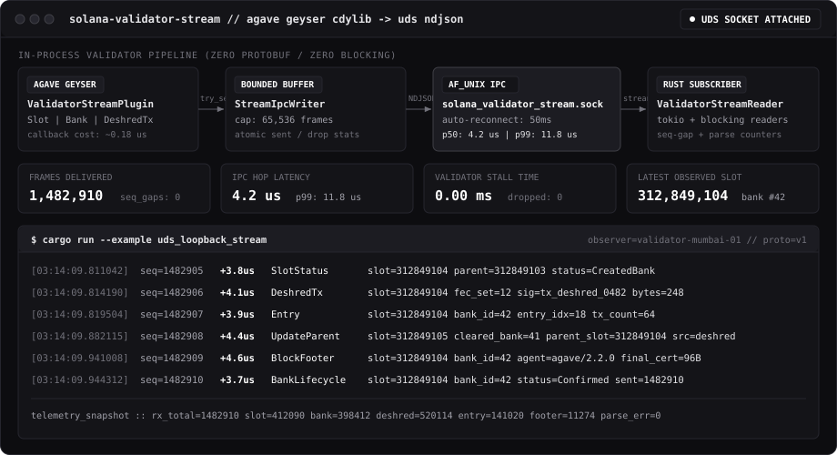

# solana-validator-stream


Fast Agave validator plugin that streams live Solana slot, bank, and shred events over `/tmp/solana_validator_stream.sock` as simple JSON lines.

Runs on pure divine code and 3am adrak chai, built because compiling 40 crates of gRPC protobufs just to read data on the same Linux box was turning my laptop fan into a helicopter.



## what this does

- Plugs straight into Agave via `_create_plugin` (when i wrote that `unsafe extern "C"` pointer only me and bhagwan knew how it worked, now only bhagwan knows).
- Pushes events into a fixed-size channel with `try_send` in ~0.2 microseconds.
- Drops extra frames if your reader hangs or goes for a samosa break (not a bug bhai, free speed feature so the validator thread never blocks).
- Reconnects on its own every 50ms if your reader restarts or closes the pipe.
- Streams 8 event types: `SlotStatus`, `BankLifecycle`, `BlockFooter`, `UpdateParent`, `DeshredTx`, `Entry`, `BlockMeta`, and `Heartbeat`.
- Gives you both async Tokio (`ValidatorStreamReader`) and simple blocking (`BlockingStreamReader`) Rust clients.

## copy and run in 60 sec

```bash
# 1. clone and run all socket tests
git clone https://github.com/LevCodeLab/solana-validator-stream.git
cd solana-validator-stream
cargo test --workspace

# 2. build the plugin shared library (.so on linux, .dylib on mac)
cargo build --release
```

Start your validator with [`config/validator-stream.json`](./config/validator-stream.json):

```bash
agave-validator \
  --geyser-plugin-config ./config/validator-stream.json \
  --ledger ./test-ledger
```

Read live frames in Rust:

```rust
use solana_validator_stream::{StreamPayload, ValidatorStreamReader, DEFAULT_SOCKET_PATH};

#[tokio::main]
async fn main() -> Result<(), Box<dyn std::error::Error>> {
    let (mut reader, mut rx) = ValidatorStreamReader::bind(DEFAULT_SOCKET_PATH, 4096)?;

    while let Some(frame) = rx.recv().await {
        if let StreamPayload::SlotStatus { slot, status, .. } = frame.payload {
            println!("seq={} slot={} status={}", frame.sequence, slot, status);
        }
    }

    reader.shutdown();
    Ok(())
}
```

Or watch raw JSON lines straight in your terminal at 2am:

```bash
nc -U -l /tmp/solana_validator_stream.sock | jq .
```

## wire frame sample

One JSON line (`\n` at the end) per event:

```json
{"sequence":1482906,"observer_validator":"validator-mumbai-01","observed_at_nanos":1760000000814190000,"payload":{"type":"BankLifecycle","data":{"slot":312849104,"bank_id":42,"parent_slot":312849103,"status":"Confirmed","bank_hash":null}}}
```

## where to edit code

- [`src/events.rs`](./src/events.rs): wire frame struct and all 8 `StreamPayload` event types.
- [`src/config.rs`](./src/config.rs): JSON config loader and default socket settings.
- [`src/ipc.rs`](./src/ipc.rs): non-blocking `StreamIpcWriter`, drop counter, and broken-pipe reconnect loop.
- [`src/plugin.rs`](./src/plugin.rs): `ValidatorStreamPlugin` and Agave `GeyserPlugin` trait hooks.
- [`src/reader.rs`](./src/reader.rs): `ValidatorStreamReader` (Tokio) and `BlockingStreamReader` (std) helpers.
- [`src/lib.rs`](./src/lib.rs): crate exports and the `_create_plugin` C ABI loader function.
- [`config/validator-stream.json`](./config/validator-stream.json): sample validator config file.
- [`tests/stream_integration.rs`](./tests/stream_integration.rs): UDS roundtrip, reconnect, and drop counter tests.

## license

MIT. Copyright (c) 2026 LevCodeLab. See [`LICENSE`](./LICENSE).
